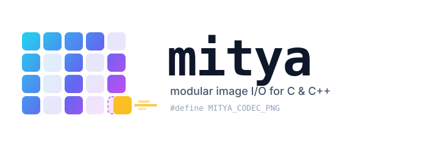

# Mitya



A small modular image loading and saving library for C and C++, built around a plain C core with a header-only C++23 wrapper.

**Formats:** PNG (via libpng, optional) and PNM (PPM/PGM, ASCII `P2`/`P3` and binary `P5`/`P6`).
Additional formats can be plugged in at b`uild time with the user-codec hook — see [User-defined codecs](#user-defined-codecs).

## Features

- **C core, C++ wrapper** — use `mitya/image.h` from C, or `mitya/image.hpp` from C++23 with `std::expected`-based error handling.
- **Multiple pixel types** — `U8`, `U16`, `U32`, `F32`, `F64`, with automatic conversion on load/save when you request a different type than the file holds.
- **Formats:** PNG and PNM support in library by default(optional)
- **Pluggable codecs** — register your own `mitya_codec_t` via one macro define; new formats appear as real enum constants (`MITYA_IMAGE_FORMAT_QOI`, `mitya::Format::QOI`) with LSP completion.
- **No exceptions in the C core** — error codes throughout; the C++ wrapper converts them to `std::expected`.
- **Single allocation per image**, owned by the library, freed with `mitya_image_destroy` / RAII in C++.

## Requirements

- CMake 3.14 or later
- A C23-capable C compiler and a C++23-capable C++ compiler (the C++ wrapper needs `std::expected`)
- libpng — only if `MITYA_ENABLE_PNG` is `ON`

## Building

```sh
cmake -B build
cmake --build build
```

### CMake options

| Option | Default | Description |
| ------------------ | ------- | --------------------------------------------- |
| `MITYA_ENABLE_PNG` | `OFF` | Build the PNG codec (requires libpng) |
| `MITYA_ENABLE_PNM` | `OFF` | Build the PNM (PPM/PGM) codec |

Disable a codec with e.g. `-DMITYA_ENABLE_PNG=OFF`.

### Using mitya from another CMake project

With `FetchContent`:
```cmake
include(FetchContent)

FetchContent_Declare(mitya GIT_REPOSITORY https://github.com/navithecoderboi/mitya.git GIT_TAG main)
FetchContent_MakeAvailable(mitya) 

target_link_libraries(your_app PRIVATE mitya)
```

Then include the headers:
```c
#include <mitya/image.h>
```

```cpp
#include <mitya/image.hpp>
```

## Quick start (C++)

```cpp
#include <iostream>
#include <mitya/image.hpp>

int main() {
    // create a 4x4 RGB image with 8-bit unsigned integer pixels
    auto result = mitya::Image::create(4, 4, 3, mitya::PixelType::U8);
    if (!result) {
        std::cerr << mitya::to_string(result.error()) << '\n';
        return 1;
    }

    // move the image out of the Expected wrapper
    mitya::Image image = std::move(*result);

    // Write pixels directly...
    auto* row = image.row<std::uint8_t>(0);
    row[0] = 255;
    row[1] = 0;
    row[2] = 0;  // first pixel = red

    // ...or use checked access (returns nullptr out of bounds)
    if (auto* p = image.try_at<std::uint8_t>(1, 0, 1)) *p = 128;

    // Format is inferred from the extension (.ppm -> Pnm);
    // passing an explicit format always works.
    if (auto s = image.save("output.ppm"); !s) {
        std::cerr << mitya::to_string(s.error()) << '\n';
        return 1;
    }
}
```

## Quick start (C)

```c
#include <mitya/image.h>
#include <stdio.h>

int main() {
    mitya_image_t image;
    // create a 4x4 RGB image with 8-bit unsigned integer pixels
    mitya_image_result_t result =
        mitya_image_create(&image, 4, 4, 3, MITYA_IMAGE_TYPE_U8);

    if (result != MITYA_IMAGE_SUCCESS) {
        fprintf(stderr, "load failed (%d)\n", (int)result);
        return 1;
    }

    /* pixels are laid out row-major, tightly packed (row_stride wide) */
    uint8_t* row = (uint8_t*)image.pixels;
    row[0] = 255;
    row[1] = 0;
    row[2] = 0;

    result = mitya_image_save_to_file(
        &image, "output.ppm", MITYA_IMAGE_FORMAT_PNM, MITYA_IMAGE_TYPE_U8);

    mitya_image_destroy(&image);

    if (result != MITYA_IMAGE_SUCCESS) {
        fprintf(stderr, "save failed (%d)\n", (int)result);
        return 1;
    }

    return 0;
}
```

## API overview

### Error handling

C functions return `mitya_image_result_t`:

| Result                                 | Meaning                                  |
| -------------------------------------- | ---------------------------------------- |
| `MITYA_IMAGE_SUCCESS`                  | Operation succeeded                      |
| `MITYA_IMAGE_ERROR_INVALID_ARGUMENT`   | Bad parameter                            |
| `MITYA_IMAGE_ERROR_FILE_NOT_FOUND`     | File does not exist                      |
| `MITYA_IMAGE_ERROR_IO`                 | Read/write failure                       |
| `MITYA_IMAGE_ERROR_DECODE_FAILED`      | Input is corrupt or not the given format |
| `MITYA_IMAGE_ERROR_ENCODE_FAILED`      | Image cannot be encoded in this format   |
| `MITYA_IMAGE_ERROR_OUT_OF_MEMORY`      | Allocation failed                        |
| `MITYA_IMAGE_ERROR_UNSUPPORTED_FORMAT` | Unknown format / codec not built         |


The C++ wrapper maps these to `mitya::Result`, returned inside
`mitya::Expected<T>` (`std::expected<T, Result>`) or `mitya::Status`
(`std::expected<void, Result>`). `mitya::to_string(result)` renders a message.

### Loading

```c
mitya_image_result_t mitya_image_load_from_file(
	mitya_image_t* image, const char* filename,
	mitya_image_format_t format, /* UNKNOWN = auto-detect by content */
	mitya_image_pixel_type_t desired_type); /* pixel type to convert to */

mitya_image_result_t mitya_image_load_from_buffer(
	mitya_image_t* image, const void* buffer, size_t buffer_size,
	mitya_image_format_t format, mitya_image_pixel_type_t desired_type);
```

- Auto-detection probes the built-in codecs first, then any user codecs.
- On success, `image->pixels` is allocated with `calloc`; release it with `mitya_image_destroy`.

### Saving

```c
mitya_image_result_t mitya_image_save_to_file(
	const mitya_image_t* image, const char* filename,
	mitya_image_format_t format, mitya_image_pixel_type_t desired_type);

mitya_image_result_t mitya_image_save_to_buffer(
	const mitya_image_t* image, void** buffer, size_t* buffer_size,
	mitya_image_format_t format, mitya_image_pixel_type_t desired_type);

void mitya_buffer_free(void** buffer); /* frees a buffer from save_to_buffer */
```

- Passing `desired_type` different from the image's type converts on the fly.
- Buffers returned by `mitya_image_save_to_buffer` are `malloc`'d — release them **only** with `mitya_buffer_free` (which also nulls the pointer).
- Buffers returned by a user codec's `encode` follow the same rule.

### The image struct

```c
typedef struct {
	uint32_t width;
	uint32_t height;
	uint8_t channels; /* 1 = gray, 2 = gray+alpha, 3 = RGB, 4 = RGBA */
	mitya_image_pixel_type_t type; /* U8, U16, U32, F32 or F64 */

	size_t row_stride; /* bytes between consecutive rows */
	size_t plane_stride; /* same as row_stride (single-plane layout) */

	void* pixels; /* row-major, tightly packed per row */
	size_t data_size; /* total allocated bytes */
} mitya_image_t;
```

Row `y` starts at `(uint8_t*)pixels + y * row_stride`. Channels are interleaved
(`R G B R G B ...`). Create images with `mitya_image_create` (zero-filled).

### C++ wrapper extras

- `mitya::Image::create(w, h, channels, type)` — create a zeroed image.
- `image.clone()`, `image.row<T>(y)`, `image.at<T>(x, y, c)`, `image.try_at<T>(x, y, c)` (bounds-checked, returns `nullptr`).
- `mitya::Image::load(path)` / `load_from_memory(data, size)` — with format auto-detection when omitted.
- `image.save(path)` — format inferred from the extension (`.png`, `.ppm`, `.pgm`, `.pnm`).
- `image.encode(format)` — return the encoded file as `std::vector<uint8_t>`.
- `Image::adopt(mitya_image_t&)` / `image.release()` — transfer ownership to or from the C API.

### Format support matrix

| Format | Decode | Encode | Notes |
| ------------- | ------------------ | ------------- | -------------------------------------- |
| PNG | 8/16-bit, 1–4 ch | 8/16-bit, 1–4 ch | needs `MITYA_ENABLE_PNG` |
| PNM `P2`/`P5` | grayscale | grayscale | 1 or 2 bytes per sample |
| PNM `P3`/`P6` | RGB | RGB | 1 or 2 bytes per sample |
| User codecs | via `decode` hook | via `encode` hook | see below |

Only 1- and 3-channel images can be saved as PNM; PNG accepts 1–4 channels (gray, gray+alpha, RGB, RGBA).

## User-defined codecs

You can add your own codecs to mitya **at build time**, without touching the
library's sources. A codec is a `mitya_codec_t` — three function pointers for
probe, encode and decode — and you register it by pointing one macro define at
a header that lists your codecs. The formats then appear as first-class enum
constants with editor completion.

### How it works

1. You write a small header listing your codecs as a macro invocation list.
2. You define `MITYA_USER_CODECS_HEADER` to the path of that header.
3. `mitya/image.h` expands the list into real enum constants
	 (`MITYA_IMAGE_FORMAT_QOI`, `mitya::Format::QOI`), and `src/image.c` expands
	 the same list into a second codec table that auto-detection and lookup use.

User formats are numbered `MITYA_IMAGE_FORMAT_USER_BASE + 1`, `+ 2`, ... in list order.

### Step 1 — the codec list header

`my_codecs.h`:
```c
#ifndef MY_CODECS_H
#define MY_CODECS_H

#define MITYA_USER_CODECS(X) \
	X(QOI, my_qoi_codec) \
	X(TGA, my_tga_codec)

#endif
```

Each line is `X(NAME, symbol_of_codec_object)`; the last line has no trailing backslash.
`NAME` becomes the enum constant name, so it must be unique.

### Step 2 — implement the codec

`qoi.c`:
```c
#include <mitya/image.h>

static mitya_image_result_t qoi_probe(const void* buffer, size_t size) {
	/* return MITYA_IMAGE_SUCCESS if the data looks like your format */
}

static mitya_image_result_t qoi_decode(const void* buffer, size_t size,
	mitya_image_t* image) {
	/* allocate with mitya_image_create, fill pixels, return SUCCESS */
}

static mitya_image_result_t qoi_encode(const mitya_image_t* image,
	void** buffer, size_t* buffer_size) {
/* *buffer must be malloc'd; the caller frees it with mitya_buffer_free */
}
  
const mitya_codec_t my_qoi_codec = {qoi_probe, qoi_encode, qoi_decode};
```

The codec object **must be defined in a C file** (C++ `const` objects have internal linkage — if you must use C++, wrap the definition in `extern "C"`).

Codec contract:
- `decode` allocates the image with `mitya_image_create`; the caller destroys it with `mitya_image_destroy`.
- `encode` returns a `malloc`'d buffer and sets `*buffer_size`; the caller releases it with `mitya_buffer_free`.

### Step 3 — wire it up in CMake

After `FetchContent_MakeAvailable(mitya)` (use the real library target name):
```cmake
target_sources(mitya PRIVATE ${CMAKE_CURRENT_SOURCE_DIR}/qoi.c)

target_compile_definitions(mitya PUBLIC
	"MITYA_USER_CODECS_HEADER=\"${CMAKE_CURRENT_SOURCE_DIR}/my_codecs.h\"")
```

Without CMake, pass the define on every compile that touches mitya:
```
-DMITYA_USER_CODECS_HEADER=\"/abs/path/my_codecs.h\"
```

The define is `PUBLIC`, so it propagates to anything linking mitya and shows up in `compile_commands.json` — your LSP sees the new enum values everywhere.

### Step 4 — use it

```c
mitya_image_save_to_file(&img, "a.qoi", MITYA_IMAGE_FORMAT_QOI, MITYA_IMAGE_TYPE_U8);
```

```cpp
img.save("a.qoi", mitya::Format::QOI);
```


### Limitations
- `save("a.qoi")` **without an explicit format** only recognizes the built-in  extensions (`.png`, `.ppm`, `.pgm`, `.pnm`). User codecs always need the explicit format argument.
- The user codec list is fixed at library compile time; it cannot be extended afterwards.
- Enumerator names must be unique and must not clash with the built-in ones.

## Contributing
- Open an issue for bugs or feature proposals
- Keep changes focused and include a clear description
- Match existing code style and C++ conventions